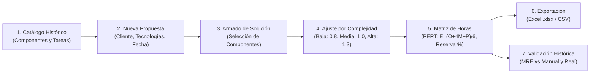

# Prototipo de Estimación de Tareas Técnicas para Propuestas de Desarrollo a la Medida: Caso Dominio Estudio

> **Trabajo de Grado – Objetivo Específico 3**  
> **Estudiante:** Holnaver Dagua Cunda  
> **Asesor:** Elkin Rojas  
> **Modalidad:** Práctica Profesional – Instituto Superior de Educación Rural (ISER)  
> **Fecha:** Octubre de 2026  

---

## 📌 1. Descripción del Proyecto

En **Dominio Estudio**, la estimación de las horas de las tareas técnicas para propuestas a la medida se realiza tradicionalmente de forma manual y dependiente del juicio del personal senior. Esto incrementa la sobrecarga sobre el equipo senior, extiende los tiempos de respuesta comercial y genera variabilidad entre una propuesta y otra.

Este proyecto implementa una solución de software orientada a resolver dicha problemática mediante tres ejes metodológicos:
1. **Descomposición de la solución en tareas técnicas:** Estructuración modular por perfiles técnicos (*Backend, Frontend, QA, DevOps*).
2. **Estimación de Tres Puntos (PERT - Cohn, 2005):** Considera valores de tiempo Optimista ($O$), Más Probable ($M$) y Pesimista ($P$) junto a su desviación estándar ($\sigma$).
3. **Catálogo con base en datos históricos:** Las horas de referencia provienen de proyectos anteriores ejecutados por Dominio Estudio.

El prototipo funciona como una **herramienta de apoyo a la decisión**, permitiendo tanto el cálculo paramétrico automatizado como la edición manual de cualquier cifra sujeta a justificación técnica obligatoria (RF-09).

---

## 🏗️ 2. Arquitectura y Tecnologías

El sistema adopta una arquitectura desacoplada y contenerizada conforme a los estándares de Dominio Estudio:

| Capa | Tecnología | Función Principal |
| :--- | :--- | :--- |
| **Frontend (UI)** | React JS 18, Vite 6, Tailwind CSS, Lucide Icons | Interfaces para catálogo, propuestas, armado modular, matriz interactiva y comparación histórica. |
| **Backend (API)** | Node.js, Express, ExcelJS, CSV-Stringify | Motor de cálculo PERT, reglas de complejidad, trazabilidad, exportación y endpoints REST. |
| **Base de Datos** | SQLite (desarrollo local zero-config) / MySQL 8.0 (producción) | Modelo de datos relacional para componentes, tareas, referencias de horas y propuestas. |
| **Despliegue** | Docker & Docker Compose | Contenedores reproducibles para Frontend (Nginx), Backend (Node) y Base de Datos (MySQL). |
| **Control de Versiones** | Git | Flujo de control de versiones y revisión de la empresa. |

### Diagrama de Flujo de la Solución



---

## 📐 3. Modelo Matemático de Estimación

### 1. Cálculo de Tres Puntos PERT por Tarea
$$E = \frac{O + 4M + P}{6}$$
$$\sigma = \frac{P - O}{6}$$
- $O$ (Optimista): Menor tiempo observado en referencias históricas.
- $M$ (Probable): Mediana de las horas registradas en proyectos anteriores.
- $P$ (Pesimista): Mayor tiempo registrado en proyectos anteriores.

### 2. Horas Ajustadas por Complejidad
$$H = E \times f$$
Donde $f$ es el factor de complejidad asignado al componente:
- **Baja:** $f = 0.8$
- **Media:** $f = 1.0$
- **Alta:** $f = 1.3$
*(Los factores son calibrables por propuesta).*

### 3. Total de la Propuesta con Reserva de Contingencia
$$\text{Total Base} = \sum H_{\text{componentes}}$$
$$\text{Horas Reserva} = \text{Total Base} \times \left(\frac{\text{Reserva}\%}{100}\right)$$
$$\text{Gran Total} = \text{Total Base} + \text{Horas Reserva}$$

### 4. Incertidumbre y Desviación Acumulada
$$\sigma_{\text{total}} = \sqrt{\sum \sigma_i^2}$$
**Intervalo Probabilístico:** $[\text{Gran Total} - \sigma_{\text{total}}, \text{Gran Total} + \sigma_{\text{total}}]$

### 5. Error Relativo de Magnitud (MRE)
$$\text{MRE} = \frac{|\text{real} - \text{estimado}|}{\text{real}}$$

---

## 🚀 4. Instalación y Puesta en Marcha

### Prerrequisitos
- Node.js v18 o superior y npm.
- (Opcional) Docker y Docker Compose si se desea levantar con MySQL en contenedores.

### Opción 1: Ejecución Inmediata en Entorno Local (SQLite Zero-Config)
```bash
# 1. Clonar el repositorio y acceder a la carpeta
cd Dominio-Estudio

# 2. Instalar dependencias completas
npm run install:all

# 3. Inicializar la base de datos y cargar catálogo de proyectos anteriores
npm run seed

# 4. Iniciar el Backend (Terminal 1)
npm run dev:backend
# API corriendo en http://localhost:4000

# 5. Iniciar el Frontend (Terminal 2)
npm run dev:frontend
# Aplicación web abierta en http://localhost:3000
```

### Opción 2: Ejecución con Docker Compose (MySQL + Backend + Nginx Frontend)
```bash
docker-compose up -d --build
```
- Aplicación Web: `http://localhost:3000`
- API Backend: `http://localhost:4000/api`
- MySQL: `localhost:3306`

---

## 🧪 5. Pruebas Automatizadas

El sistema incluye una suite de pruebas unitarias y de integración que verifican las fórmulas matemáticas de PERT y los requisitos funcionales RF-01 a RF-10:

```bash
npm test
```
*Salida:*
```text
✔ RF-07: Horas esperadas y desviación PERT (O=10, M=16, P=28)
✔ RF-06: Factores de complejidad (baja: 0.8, media: 1.0, alta: 1.3)
✔ RF-03: Derivación de O, M, P desde referencias históricas
✔ RF-07: Totales con reserva configurable e intervalos
✔ RF-10: Comparación y Error Relativo MRE
✔ Integración API REST (RF-01 a RF-10)
```

---

## 📋 6. Matriz de Cumplimiento de Requisitos

| Requisito | Descripción | Estado |
| :---: | :--- | :---: |
| **RF-01** | Crear, editar y desactivar componentes del catálogo | ✅ Implementado |
| **RF-02** | Registrar las tareas técnicas con horas O, M, P | ✅ Implementado |
| **RF-03** | Registrar origen de las horas: proyecto y tipo (real o estimada) | ✅ Implementado |
| **RF-04** | Crear propuesta (nombre, cliente, tecnologías, fecha) | ✅ Implementado |
| **RF-05** | Armar la solución seleccionando componentes del catálogo | ✅ Implementado |
| **RF-06** | Ajustar la complejidad (baja, media, alta) de cada componente | ✅ Implementado |
| **RF-07** | Calcular horas esperadas por tarea, componente y en total | ✅ Implementado |
| **RF-08** | Generar matriz de estimación y exportar a Excel (.xlsx) y CSV | ✅ Implementado |
| **RF-09** | Editar manualmente las horas de una tarea con justificación técnica | ✅ Implementado |
| **RF-10** | Consultar propuestas y registrar estimación manual para calcular MRE | ✅ Implementado |

---

## 📁 7. Entregables Incluidos en el Repositorio

- **Prototipo Funcional Completo:** Código fuente en `frontend/` y `backend/`.
- **Despliegue Contenerizado:** `docker-compose.yml`, `backend/Dockerfile`, `frontend/Dockerfile`.
- **Catálogo Inicial Pre-cargado:** Datos de 6 componentes y 22 tareas técnicas en `backend/src/seeds/initialData.js`.
- **Matriz de Estimación de Ejemplo Exportada:**
  - [matriz_estimacion_ejemplo.xlsx](file:///c:/Users/User/Documents/Antigravity/Dominio-Estudio/docs/matriz_estimacion_ejemplo.xlsx)
  - [matriz_estimacion_ejemplo.csv](file:///c:/Users/User/Documents/Antigravity/Dominio-Estudio/docs/matriz_estimacion_ejemplo.csv)
- **Guía Básica de Uso:** [docs/GUIA_DE_USO.md](file:///c:/Users/User/Documents/Antigravity/Dominio-Estudio/docs/GUIA_DE_USO.md) y de forma interactiva en la interfaz web.
- **Informe de Validación con Propuesta Histórica:** [docs/INFORME_VALIDACION.md](file:///c:/Users/User/Documents/Antigravity/Dominio-Estudio/docs/INFORME_VALIDACION.md) (Caso E-Commerce Artesanías y Reservas).

---

## 📚 8. Referencias Bibliográficas

- **[1] Terlapu, P. V., et al.** (2024). *Improved software effort estimation through machine learning: Challenges, applications, and feature importance analysis*. IEEE Access, vol. 12, pp. 138663–138701.
- **[3] Jørgensen, M., & Shepperd, M.** (2007). *A systematic review of software development cost estimation studies*. IEEE Transactions on Software Engineering, vol. 33, no. 1, pp. 33–53.
- **[4] Cohn, M.** (2005). *Agile Estimating and Planning*. Upper Saddle River, NJ, USA: Prentice Hall.
- **[6] Schwaber, K., & Sutherland, J.** (2020). *The Scrum Guide: The Definitive Guide to Scrum: The Rules of the Game*.
